# Obsidian FHD: a modern 1080p skin for enigma2 (OpenPLi, OpenATV and other images)

A dark "Obsidian Telemetry" skin, applied from the Stitch prototype in
`stitch_enigma2_comprehensive_ui_skin/`: OLED-black canvas, electric-cyan and RF-amber
accents, Inter for text and JetBrains Mono for technical data. It is built on the structure of
PLi-FullNightHD, the reference Full HD skin maintained by OpenPLi, so all of its ~480 screen and
plugin definitions use widget names that the OpenPLi code expects.

- **Resolution:** 1920×1080 (the box must support Full HD skins)
- **Fonts:** Inter, JetBrains Mono and Noto Kufi Arabic (for Arabic text) ship inside the skin (`Obsidian-FHD/fonts`, SIL OFL licence).
- **Tested statically:** `tools/validate-skin.ps1` checks XML, colours, fonts, panels and images.
- **Weather (optional):** with the OAWeather plugin installed, the infobar shows the current
  weather in the top-left corner and the OAWeather screens use the Obsidian style. Without the
  plugin, nothing changes.

## Screenshots

Captured on a Vu+ Solo2 with OpenATV 7.6 (on-screen layer only, over a neutral background).

| Infobar | Channel list |
|---|---|
| 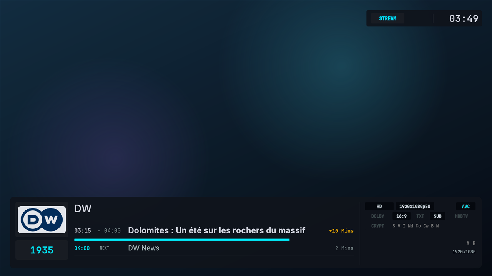 |  |
| **Main menu** | **Setup menu** |
| 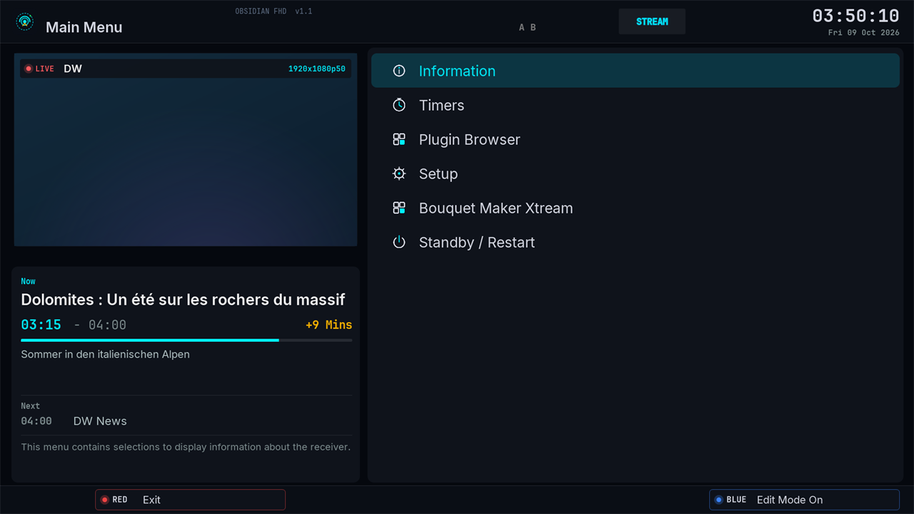 | 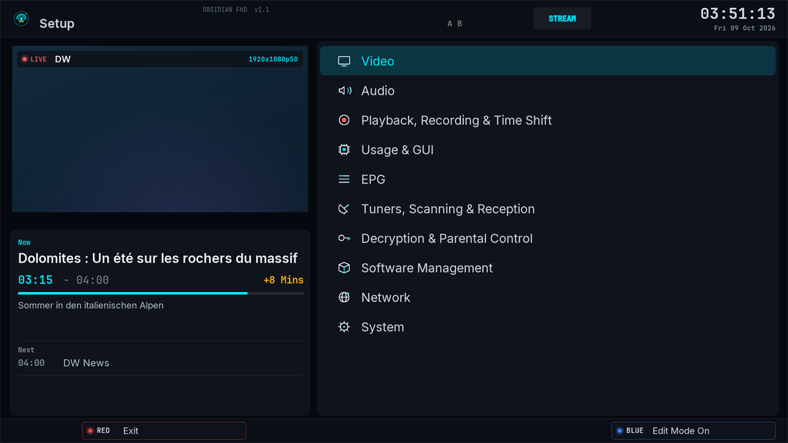 |
| **Settings** | **EPG grid** |
| 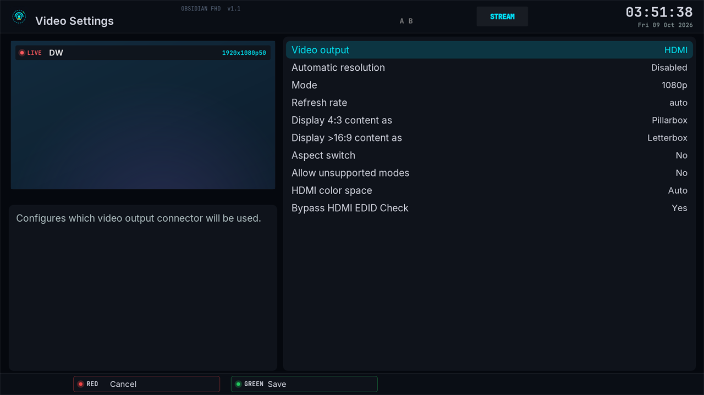 | 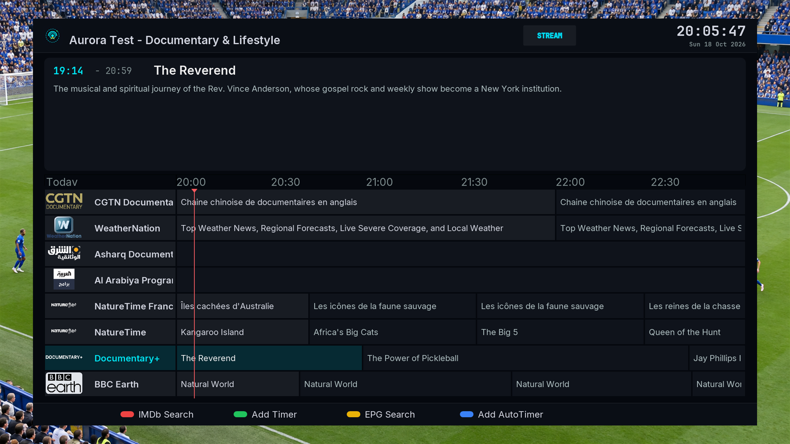 |
| **Event view** | **Message box** |
| 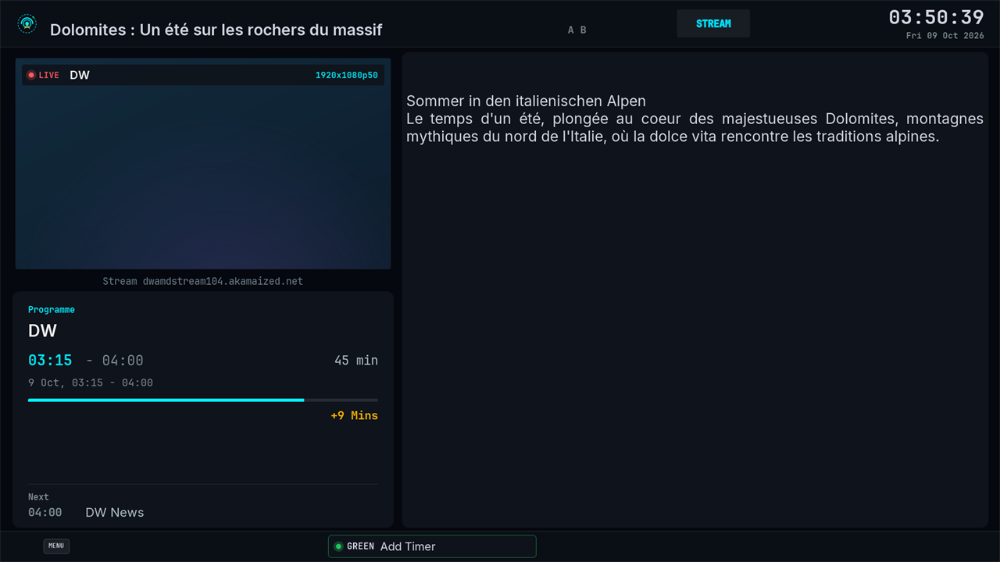 | 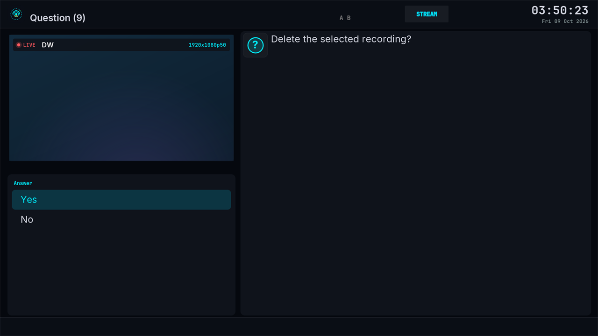 |
| **Install plugins** | **Volume** |
| 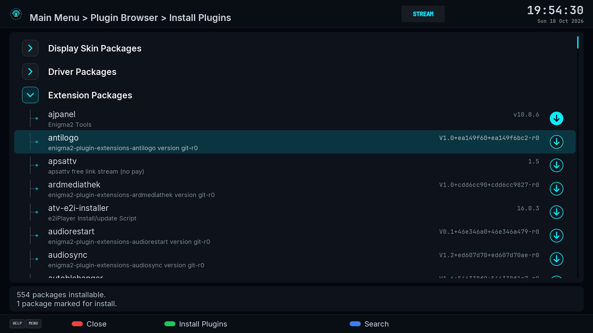 | 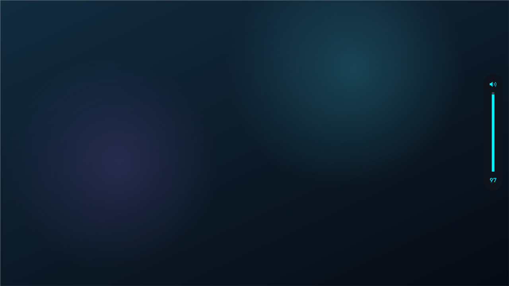 |

## Floating menu (new in 1.4, optional)

A second menu style: floating cards over live TV, with a live dashboard next to the main menu
(temperature, CPU load, fan, uptime, RAM, flash and disks with their model, network speed and an
online badge). Texts follow the receiver language (English, French, Arabic).

**Turn it on:** Menu → **Obsidian Apps** → **Floating menu** → GREEN (Turn on), then restart the GUI when asked.
Turn it off there to go back. The classic menus stay the default. The **Floating channel list** is switched on the
same way, and **Weather** and **Bitrate** can be hidden there too.

| Main menu | Submenu |
|---|---|
| 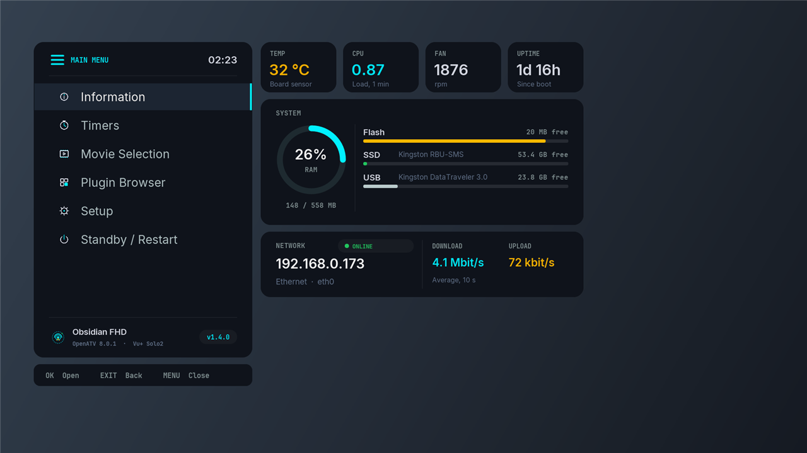 | 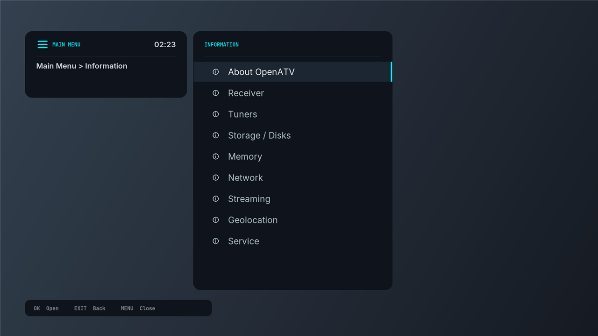 |

- The dashboard values come from two small converters installed with the package
  (`ObsidianSysInfo`, `ObsidianMenuTitle`). They read local system files every 10 seconds, only
  while the menu is open.
- **Online badge:** to check the internet connection, the receiver opens a short connection to a
  public DNS server (1.1.1.1 or 8.8.8.8, port 53) at most once a minute, only while the menu is
  open. Nothing is sent and no data is collected.
- **Update check:** while the Floating main menu or Obsidian Apps is open, the receiver reads
  one small file from this repository (`release/version.txt`) at most every 6 hours. When a newer
  version exists, the menu footer says so and **About & update** in Obsidian Apps
  installs it with the same command as Option A below.

## Install

### Option A: one command on the receiver (recommended)
Open an SSH or telnet session to the receiver and run:
```sh
wget -qO- https://raw.githubusercontent.com/dali44g/Obsidian-FHD/main/install.sh | sh
```
Run the same command again to update. Then select **Obsidian-FHD** in the skin settings.

### Option B: install the package by hand
Download `release/enigma2-plugin-skins-obsidian-fhd_all.ipk` from this repository, copy it to
`/tmp` on the receiver and run `opkg install /tmp/enigma2-plugin-skins-obsidian-fhd_all.ipk`.

### Option C: SSH from Windows 10/11 (developers)
```powershell
powershell -ExecutionPolicy Bypass -File tools\deploy.ps1 -Box 192.168.1.50 -Activate
```
Without `-Activate` it only copies the files; you then select the skin on the box.

### Option D: FTP / WinSCP
1. Copy the `Obsidian-FHD` folder to `/usr/share/enigma2/` on the box.
2. On the box, open **Menu → Setup → System → User interface → Skin setup**, choose **Obsidian-FHD**
   and let the GUI restart.

If something goes wrong, OpenPLi falls back to its default skin automatically.

## Folder layout
```
Obsidian-FHD/              → copy to /usr/share/enigma2/Obsidian-FHD
  skin.xml               fonts, palette, window style, screens
  skin_templates.xml     shared building blocks (header, footer, infobar, channel list…)
  skin_plugins.xml       screens for popular plugins
tools/
  gen-graphics.ps1       regenerates all themed PNGs from the palette
  validate-skin.ps1      static checks, run before every deploy
  preview.ps1            renders rough PNG previews of screens into preview/
  deploy.ps1             validate + copy to the box (+ optional activation)
  modernize-screens.ps1  applies the card layout / list styling to every templated screen (idempotent)
  screens-obsidian.xml   hand-built screens (media player OSD, overlays, radio list, ...)
  apply-screens.ps1      swaps the screens from screens-obsidian.xml into skin.xml
  map-colours.ps1        maps hard-coded plugin colours onto the palette (idempotent)
```

## Changing the colours
1. Edit the palette at the top of `tools/gen-graphics.ps1` and run it.
2. Edit the matching `<colors>` in `Obsidian-FHD/skin.xml`. enigma2 colours are `#AARRGGBB`, where
   `AA=00` is opaque and `AA=ff` is fully transparent (the reverse of CSS).
3. Run `tools/validate-skin.ps1`, then deploy.

The main colours are `aBg`, `aCard`, `aLine`, `aAccent` (cyan), `aAmber`, `aText` and `aMuted`. The older
names (`secondFG`, `selectorcolor`, …) are mapped onto these, so inherited screens follow the
palette too.

## Notes
- Rounded corners use the `cornerRadius` attributes from recent OpenPLi releases. On older
  images enigma2 ignores them and draws square corners, so nothing breaks.
- If a screen looks wrong on your box, the GUI log has the details:
  `grep -i skin /home/root/logs/*.log` or run `init 4; enigma2` over SSH.

## Credits
Derived from PLi-FullNightHD by littlesat / OpenPLi (based on Magic_HD_Shadow_MiniTV by Vali),
which is freeware. The original credit line is kept in `skin.xml` as its licence requires.

## Stitch prototype → enigma2 mapping
| Prototype element | In the skin |
|---|---|
| Global status bar (delivery system, sat, freq, tuners A–D, SNR/AGC/BER, clock) | Header of every full-screen window (`TopTemplate`) |
| 4-colour action strip | Footer pills (`ButtonTemplate`), labels come from each screen |
| Live TV infobar (CH POS, badges, meters, tuners, ECM line) | `InfoBarTemplate` |
| ECM telemetry HUD | `SecondInfoBar` (INFO twice) |
| Channel / bouquet / PIP guide | `ChannelSelectionTemplate` |
| Graphical multi-EPG | `GraphMultiEPG` colours and fonts |
| OSD main menu (cyan active row) | `MenuTemplate` |

Not reproducible in enigma2 (no data source in OpenPLi): IP address, CPU temp/RAM,
control words, constellation plot, LNB spectrum, device model badge. These were left out.
Fonts are © their authors under the SIL Open Font License (see `Obsidian-FHD/fonts/*-OFL.txt`).

## How the design reaches every screen
- **Every list** (settings, plugins, file browsers, choice boxes): the window style's
  `bsListboxEntry` border draws the cyan selection bar on the selected row, and skin parameters
  (`ChoicelistName`, `SelectionListDescr`, `FileListName`, `PluginBrowser*`, ...) give Python-built
  rows 52-54px with centred text.
- **~360 template screens**: `SelectionTemplate` adds the left info card and right content card;
  `modernize-screens.ps1` makes widgets inside the cards transparent over the card colour.
- **Icons**: checkboxes, folders, file types, MessageBox, timer states, badges, keyboard keys are
  regenerated by `gen-graphics.ps1` with the same names/sizes OpenPLi loads.
- **Plugins not covered by `skin_plugins.xml`** use their own built-in layout, but still get the
  fonts, colours, window frame, list selection and icons above.

After editing anything, re-run in this order:
`gen-graphics.ps1` → `apply-screens.ps1` → `modernize-screens.ps1` → `map-colours.ps1` → `validate-skin.ps1`.

## Licence
CC BY-NC-SA 4.0, see `LICENSE` (credits for PLi-FullNightHD and the fonts are listed there).
