# Obsidian FHD: a modern 1080p skin for enigma2 (OpenPLi, OpenATV and other images)

A dark "Obsidian Telemetry" skin: OLED-black canvas, electric-cyan and RF-amber accents, Inter for text and
JetBrains Mono for technical data. It is built on the structure of
PLi-FullNightHD, the reference Full HD skin maintained by OpenPLi, so all of its ~480 screen and
plugin definitions use widget names that the OpenPLi code expects.

- **Resolution:** 1920×1080 (the box must support Full HD skins)
- **Fonts:** Inter, JetBrains Mono and Noto Kufi Arabic (for Arabic text) ship inside the skin (SIL OFL licence).
- **Weather (optional):** with the OAWeather plugin installed, the infobar shows the current
  weather in the top-left corner and the OAWeather screens use the Obsidian style. Without the
  plugin, nothing changes.

## Screenshots

Captured on a Vu+ Solo2 with OpenATV 7.6 (on-screen layer only, over a neutral background).

| Infobar | Channel list |
|---|---|
|  |  |
| **Main menu** | **Setup menu** |
|  |  |
| **Settings** | **EPG grid** |
|  | 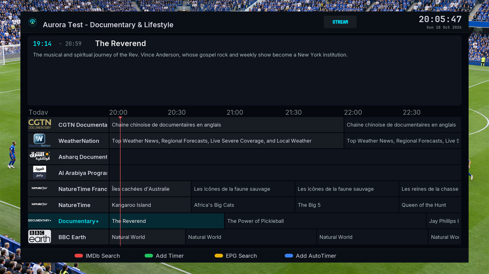 |
| **Event view** | **Message box** |
|  |  |
| **Install plugins** | **Volume** |
| 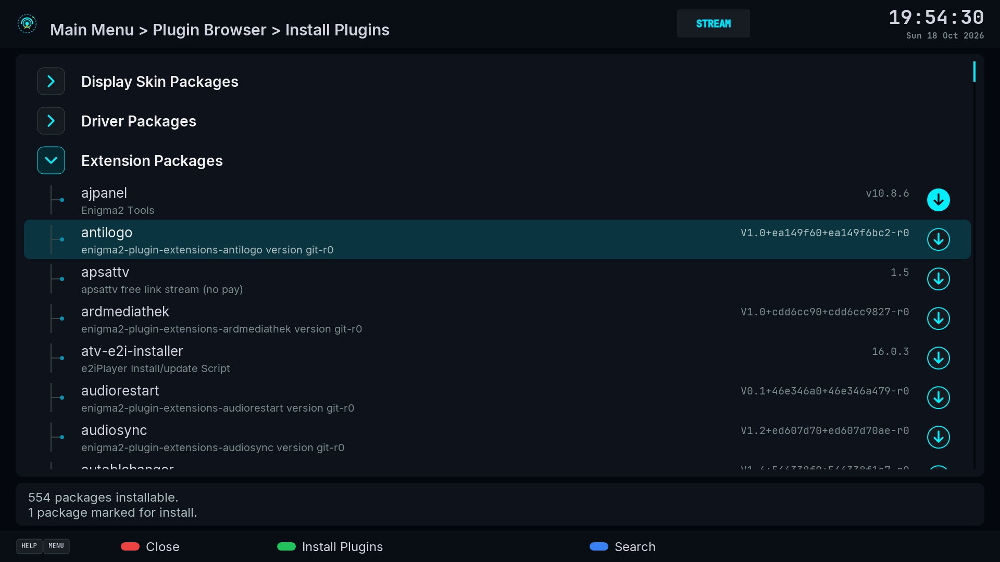 |  |

### New in 1.5

Captured on a Vu+ Solo2 with OpenATV 8.0.1, over live TV.

| Infobar (Halo) | Channel list (Floating) |
|---|---|
| 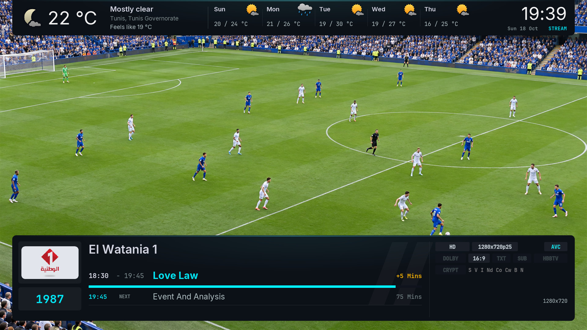 | 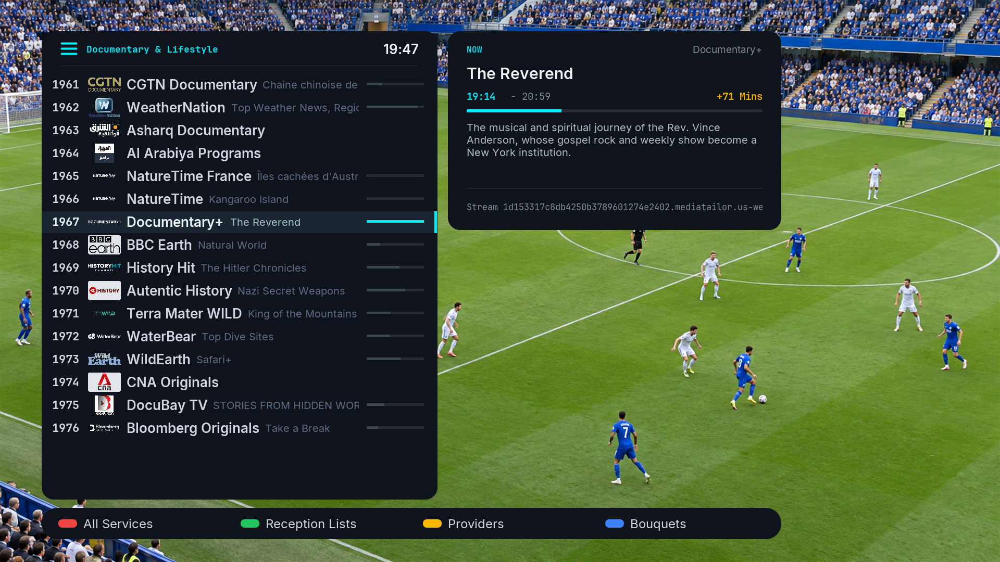 |
| **Obsidian Apps** | **Main menu with dashboard** |
| 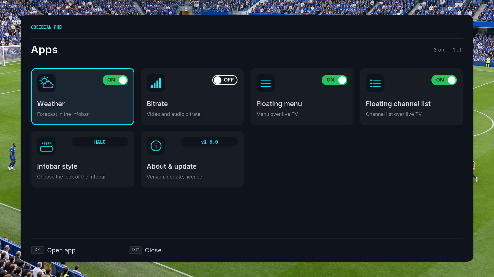 | 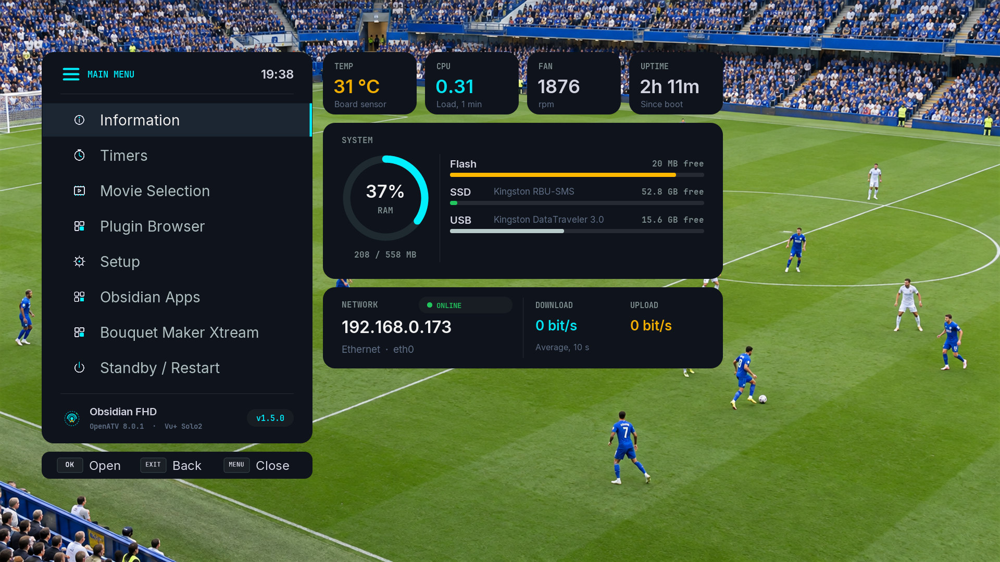 |
| **Floating submenu** | **Weather** |
| 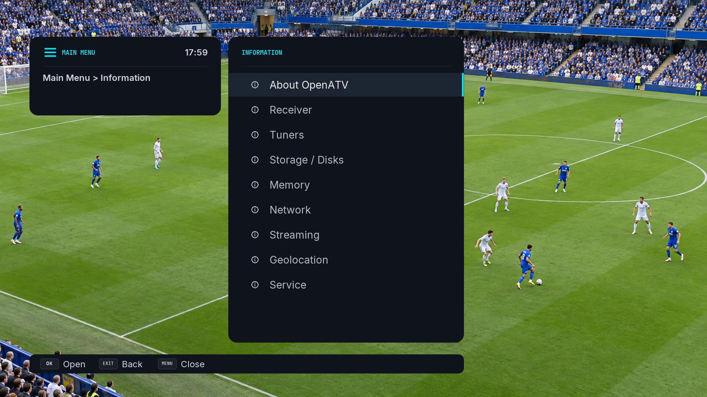 | 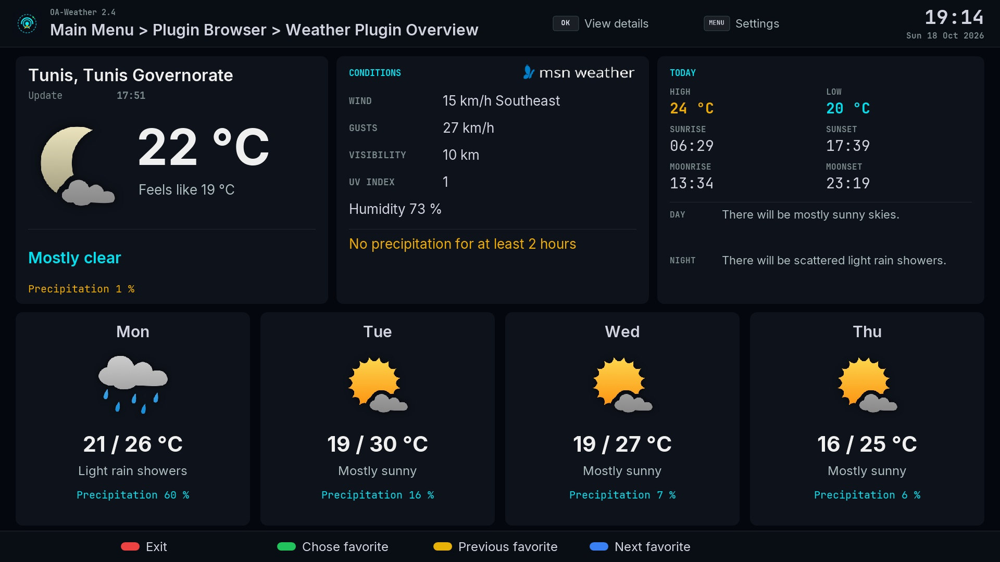 |
| **Quick menu** | **Plugin browser** |
| 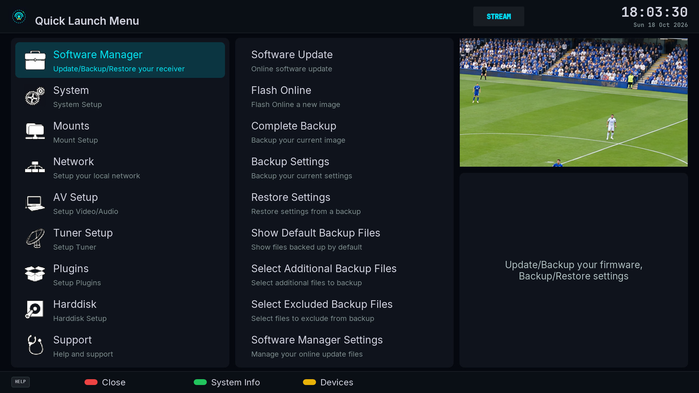 | 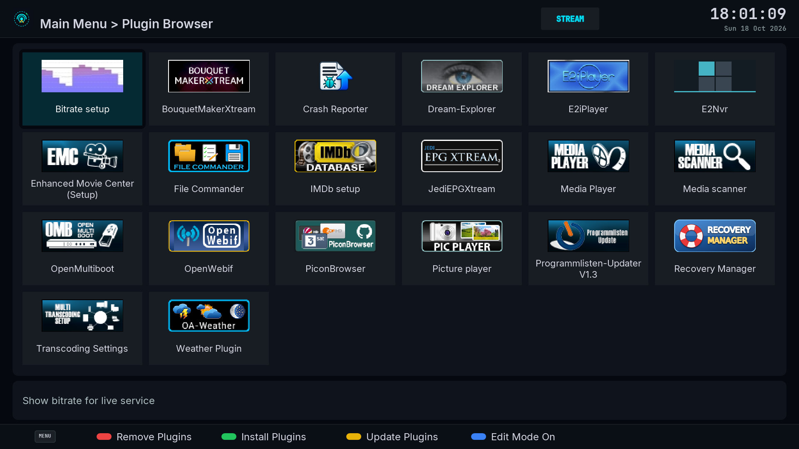 |

### New in 1.6

Captured on a Vu+ Solo2 with OpenATV 8.0.1, over live TV.

| Edge main menu with dashboard | Edge channel list |
|---|---|
| 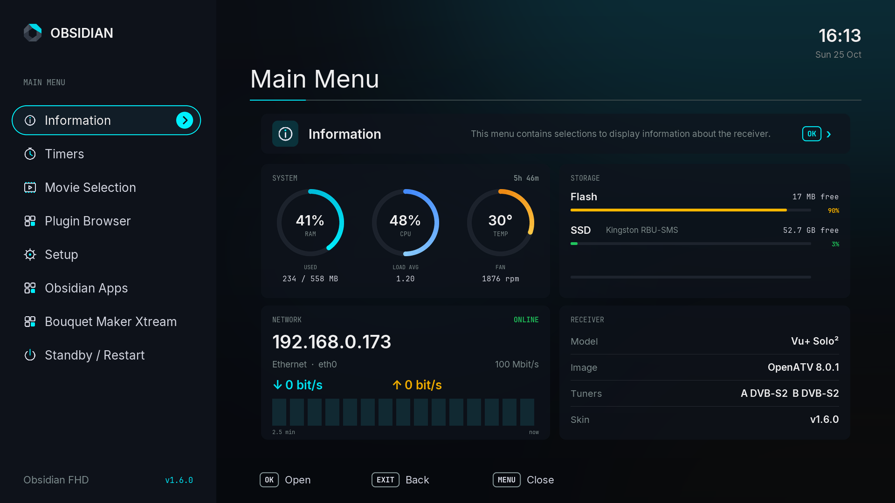 | 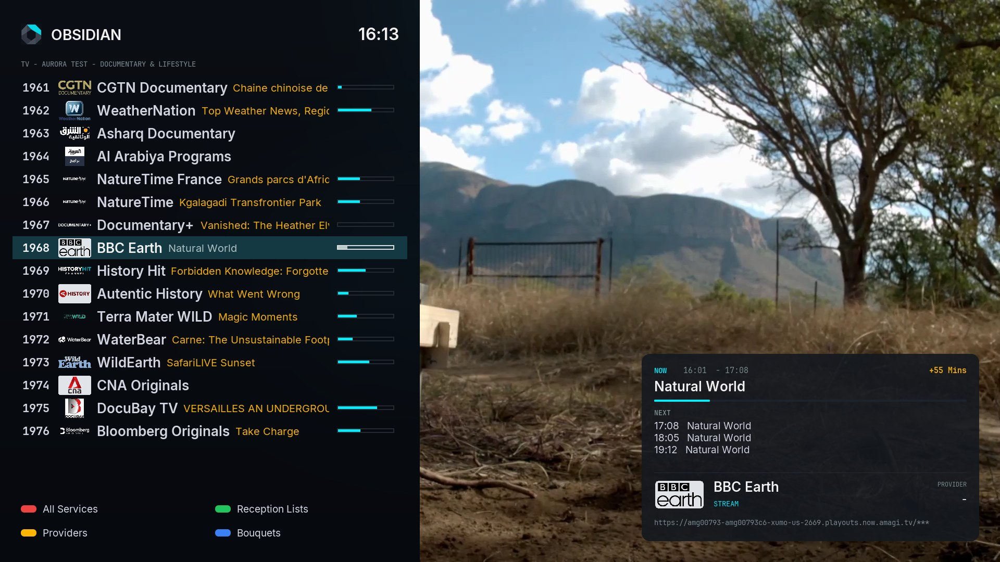 |

- **Edge style (free download):** a new look for the main menu, submenus, settings and the channel list, with a
  hardware dashboard (memory, CPU and temperature rings, storage, network chart) and an information card for the
  selected channel. Get it from Menu → **Obsidian Apps** → **Styles** → **Edge** → Download. Menus and the channel
  list can each use Classic, Floating or Edge; Edge is removed again in one step.
- **Obsidian Mawaqit (free add-on):** prayer times of your mosque from mawaqit.net, with a full-screen prayer
  screen, the day's prayers beside the infobar, a next-prayer tab, a reminder before the adhan and adhan and iqama
  alerts over live TV (English, French, Arabic). Install it from Menu → **Obsidian Apps** → **Mawaqit**.
  It needs a free mawaqit.net account: the password is used once to get an access token and is never stored; only
  the timetable of the chosen mosque is downloaded (about once a week).
- Downloads from Obsidian Apps come from this repository's GitHub Releases; add-ons are installed only when their
  size and checksum match the published catalogue.

## Floating menu (new in 1.4, optional)

A second menu style: floating cards over live TV, with a live dashboard next to the main menu
(temperature, CPU load, fan, uptime, RAM, flash and disks with their model, network speed and an
online badge). Texts follow the receiver language (English, French, Arabic).

**Turn it on:** Menu → **Obsidian Apps** → **Floating menu** → GREEN (Turn on), then restart the GUI when asked.
Turn it off there to go back. The classic menus stay the default. The **Floating channel list** is switched on the
same way, and **Weather** and **Bitrate** can be hidden there too.

| Main menu | Submenu |
|---|---|
|  |  |

- The dashboard values come from two small converters installed with the package
  (`ObsidianSysInfo`, `ObsidianMenuTitle`). They read local system files every 10 seconds, only
  while the menu is open.
- **Online badge:** to check the internet connection, the receiver opens a short connection to a
  public DNS server (1.1.1.1 or 8.8.8.8, port 53) at most once a minute, only while the menu is
  open. Nothing is sent and no data is collected.
- **Update check:** while the Floating main menu or Obsidian Apps is open, the receiver reads
  one small file from this repository (`release/version.txt`) at most every 6 hours. When a newer
  version exists, the menu footer says so and **About & update** in Obsidian Apps
  installs it with the same command as Option A below.

## Install

### Option A: one command on the receiver (recommended)
Open an SSH or telnet session to the receiver and run:
```sh
wget -qO- https://raw.githubusercontent.com/dali44g/Obsidian-FHD/main/install.sh | sh
```
Run the same command again to update. Then select **Obsidian-FHD** in the skin settings.

### Option B: install the package by hand
Download `release/enigma2-plugin-skins-obsidian-fhd_all.ipk` from this repository, copy it to
`/tmp` on the receiver and run `opkg install /tmp/enigma2-plugin-skins-obsidian-fhd_all.ipk`.
The Edge style (`enigma2-plugin-skins-obsidian-fhd-edge_all.ipk`) and the Mawaqit add-on
(`enigma2-plugin-extensions-obsidian-mawaqit_all.ipk`) are optional and installed the same way, after the skin.

If something goes wrong, OpenPLi falls back to its default skin automatically.

## Notes
- Rounded corners use the `cornerRadius` attributes from recent OpenPLi releases. On older
  images enigma2 ignores them and draws square corners, so nothing breaks.
- If a screen looks wrong on your box, the GUI log has the details:
  `grep -i skin /home/root/logs/*.log` or run `init 4; enigma2` over SSH.

## Credits
Derived from PLi-FullNightHD by littlesat / OpenPLi (based on Magic_HD_Shadow_MiniTV by Vali),
which is freeware. The original credit line is kept in the skin as its licence requires.

## Licence
CC BY-NC-SA 4.0, see `LICENSE` (credits for PLi-FullNightHD and the fonts are listed there).
